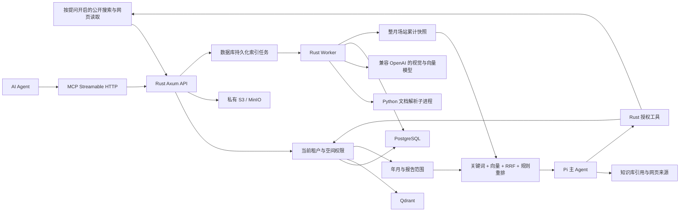

# 架构与权限

主框架为 **Rust（Axum + Tokio + SQLx）与 React 19 + TypeScript**。Python 仅作为隔离的文档解析子进程，不提供业务 API、不访问数据库、不接收模型密钥。Rust 负责存储、索引队列、视觉 / 向量模型调用、混合检索、认证、授权和 MCP。问答主 Agent 使用 Pi Agent Core 的正式 SDK，通过独立 Node.js 子进程执行工具调用循环；工具均回到 Rust 按当前用户权限执行。

模型配置按企业持久化，管理员可通过页面分别配置和实际测试问答、向量、视觉服务。配置采用 AES-256-GCM 加密，企业 ID 作为附加认证数据；读取接口与审计不包含密钥原值。检索、问答和索引任务使用开始时的配置快照，下一次请求读取新配置，独立 Worker 无需重启。向量片段记录服务地址、模型、维度的指纹，防止换服务后混用旧向量。详细行为见 [页面模型配置](model-settings.md)。

## 数据与执行路径

正式部署与当前本地环境使用 PostgreSQL、Qdrant 和 MinIO；SQLite 与磁盘存储仍可作为简易开发模式。PostgreSQL 使用预分词全文 GIN 索引，Qdrant 负责向量召回，随后采用 RRF 融合与规则重排。Qdrant 先限定租户、可查看空间与有效文档，再回查 PostgreSQL 的版本、删除状态及当前权限。生产默认要求 HTTPS，指定的内网 HTTP 入口通过显式配置开放。中文采用二字切词，英文按词切分；可后续接入行业词典和神经 reranker。SQLite 模式使用内存 BM25 和余弦相似度，最多扫描 20,000 个授权片段，达到上限会返回提示。

SQLite 扫描先对授权片段 ID 排序并限量，再读取文本和向量，避免将向量大字段一起排序而产生大量临时磁盘文件。真实磁盘容量不足仍需释放空间；SQLite / PostgreSQL 的磁盘满错误会返回 HTTP 507 和明确提示。

## 授权模型

每个账号属于一个企业、一个可选部门、一个可选直属上级。部门树和汇报链分别建模，修改时检查循环并在企业行上串行化层级变更。

空间授权对象包括全体企业成员、部门、具体用户和某用户的下属。部门和汇报授权可选择包含所有下级。**授权从上级向下继承，访问下级空间不会自动赋予上级访问权**；如果需要上级查看下级资料，应为上级用户或部门明确添加授权。

权利分别为 `can_view`（查看）、`can_create`（创建）和 `can_manage`（管理）。管理包含查看、创建、修改授权与管理文档。多条允许规则叠加；同一权利的显式拒绝优先。创建权可以独立存在，没有查看权的账号可提交新文档，但不能列出、检索或下载空间中的文档。查看/创建被拒绝时也会失去管理权。企业管理员拥有企业共享空间的权限；个人知识库由 `personal_spaces` 绑定拥有者，其他人包括企业管理员均不可访问，个人空间不能配置共享授权。

权限在服务器执行，隐藏 UI 菜单不构成安全边界。API Key 继承用户当前权限，还需满足 `search.read`、`document.read`、`document.write` 对应 scope。API Key 不能管理账号、授权或创建新密钥。停用账号后所有 API Key 与会话立即失效；撤销密钥立即生效；角色变化与密码重置会删除已有会话。

搜索、文件下载、原图、文档列表、引用与会话历史共用权限检查。模型调用完成后再次校验引用空间和文档版本。历史回答引用的资料变更、删除或撤权时，整条历史回答被隐藏，避免仅移除引用却泄露原文。已发给外部客户端的内容无法追回。

## 多模态 RAG

- TXT / Markdown / CSV：UTF-8 或 GB18030 文本。
- DOCX：段落、表格及内嵌常见图片；图像原始位置暂统一标为第 1 页。
- XLSX：工作表和单元格值；使用已缓存的公式结果，不执行公式。首版不解析 Excel 内嵌图表。
- PPTX：文本、表格、内嵌位图；不渲染矢量形状或 Office SmartArt。
- PDF：页码、文本；启用视觉模型时渲染带图像、绘图或扫描内容的页面，保留图表关联信息。
- PNG / JPEG / WebP：保留标准化原图，用视觉模型提取文字、表格、流程及语义描述。

文本与图像描述统一进入同一向量空间，因此支持文字找图片、图片找文字与图片找图片的语义内容匹配。**首版使用视觉描述与 OCR 内容作为跨模态桥梁，不是 CLIP 原生图像向量或像素相似检索**。查询图片需视觉模型；独立图片上传和扫描 PDF 在缺少视觉模型时明确失败。文档查询返回图像片段、原图地址、页码和版本。

普通文本分块约 900 个 Unicode 字符，重叠 140 字符；XLSX 保留带表头、单位、工作表、日期和行号的完整行，不硬切表格。每条文档最多 4,000 块。检索先按显式年月和报告标题限定范围，再采用关键词和向量候选的 RRF 融合与规则重排，每条文档最多返回 3 个片段。月度各场站汇总优先使用索引时从整份工作簿构建的月累计快照，避免少量随机片段遗漏场站和重复累加累计值。尚未接入独立神经重排序模型；具体流程与支持边界见 [检索与月度报表问答](retrieval.md)。问答只将授权片段发给模型，并提示忽略资料中的指令；生成模型仍可能理解错误，用户应核对引用原文。无模型时返回真实原文片段，不模拟语义或生成能力。

## 索引一致性

上传原文和数据库版本后，在同一事务创建持久化任务。Worker 原子领取任务，使用唯一令牌和两分钟租约、每 25 秒续租。视觉服务返回 429 时，在当前图片最多重试三次，按 Retry-After 秒数等待（单次最多 120 秒），未提供有效秒数时依次等待 30、60、120 秒；等待期间继续续租。认证错误不做此类重试。任务失败最多自动尝试三次。任务准备完成后锁定文档，检查最新版本、删除标记和租约，再原子替换所有片段并发布版本。崩溃后租约到期可由其他 Worker 领取，旧版本任务不能覆盖新版本。

上传新版本后旧版本索引停止参与检索，直到新版本索引成功，防止把过期制度当作最新答案。原文各版本保留供下载；删除采用软删除并即时移除检索块。源文件、历史版本及已发布解析图片由持久化清理任务删除。孤立上传和未发布的失败任务图像仍需保留/清理策略。

片段发布与删除在同一 PostgreSQL 事务写入 `vector_jobs`，Worker 使用文档写锁同步 Qdrant，失败可重试。PostgreSQL 保存向量 JSON，Qdrant 可重建；集合按模型 identity 与维度隔离。启动时已有 ready 文档加入同步队列。对象通过 `object_locations` 绑定加密存储 profile，切换配置不改变已有文件的读取位置。

`user_preferences` 控制创作自动归档，默认关闭。新图片 / 视频生成完成时与个人知识文档同事务提交；`studio_archives` 以 asset ID 保证幂等。视频按提示词和元数据建立检索内容，图片在配置视觉模型后也索引画面描述。关闭后停止新归档，已有内容保留。

## 认证和运维边界

密码使用 Argon2id。会话使用 256 位随机 token，数据库只存 SHA-256 摘要；Cookie 为 HttpOnly、SameSite=Lax，生产为 Secure。Cookie 写操作必须携带可信 Origin，MCP 也检查 Origin，阻止浏览器跨站调用和 DNS rebinding。密钥仅展示一次，服务端只存摘要。登录失败计数存数据库，并对企业标识/邮箱实施 15 分钟窗口限制。

可选 OIDC SSO 实现授权码 + PKCE + state Cookie + nonce、JWKS 验签、issuer / audience / expiry 校验；当前适配 RS256、client_secret_basic、已验证邮箱。账号须先由管理员创建，不会自动提升角色或同步组织；尚未实现 SCIM 和企业目录自动同步。

迁移受 PostgreSQL advisory lock 保护，当前 schema 版本为 4；未来结构变更应新增顺序迁移，不应修改已上线迁移。审计记录保存在租户隔离的数据库表中，可通过管理员 API 分页读取。它尚不是具备 WORM 或加密签名的外部合规审计存储。

Compose 提供内网 HTTP / 域名 HTTPS 入口、独立 Worker、PostgreSQL、Qdrant 与 MinIO。服务器数据库、向量服务和 MinIO 不向宿主机暴露端口，应用使用限定单个 bucket 的存储用户。生产环境连接真实模型与 SSO 后仍需按业务负载验证质量和吞吐。首版不包含 Kubernetes、自动扩缩容、计费、企业第三方同步连接器或 SLA 保证。
