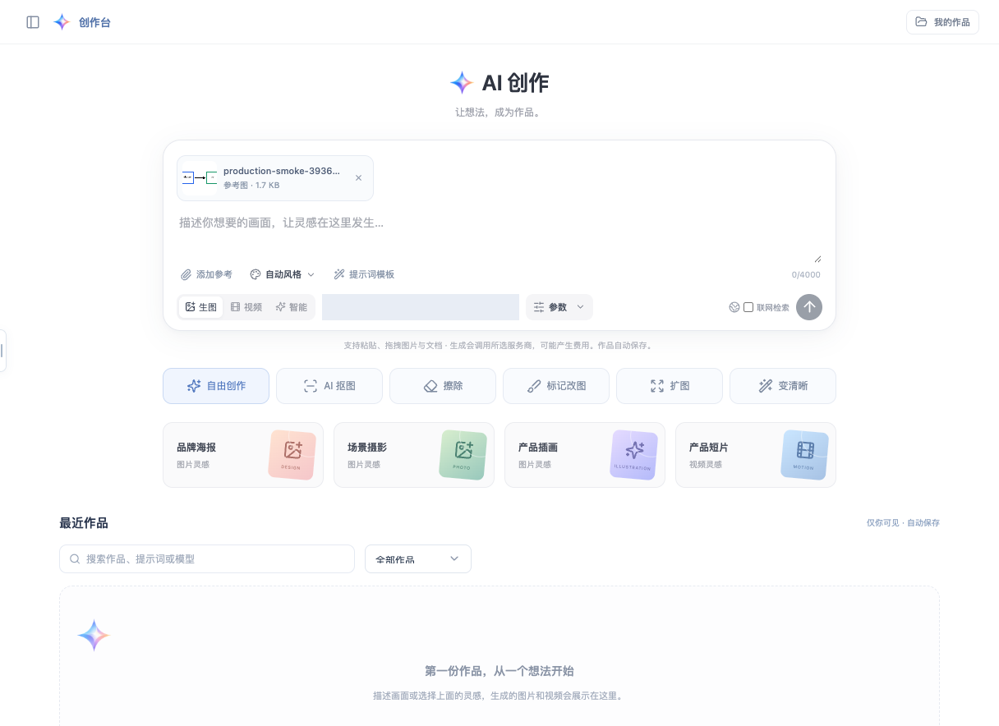
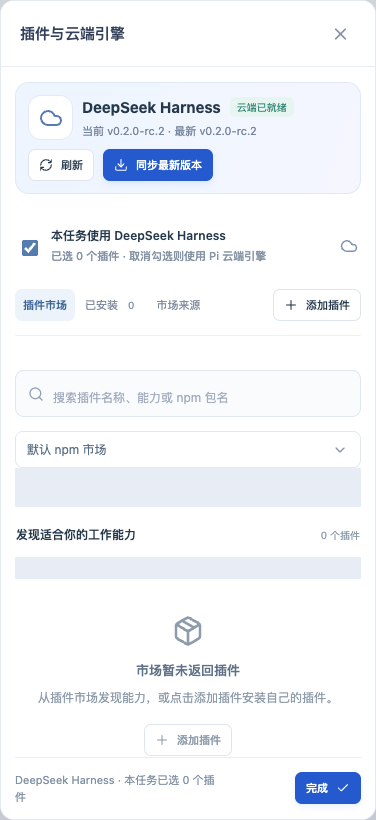

# 创作台与 DeepSeek Harness 生产发布

发布日期：2026-10-12（Asia/Shanghai）。入口：[创作台](http://192.168.1.34:18088/app?view=studio)、[知小汇 bot](http://192.168.1.34:18088/app?view=bot)。刷新已有页面即可加载新版本。

版本：`creative-harness-20261012-124002`。API 与 Worker 共用镜像 `atlas-knowledge:creative-harness-20261012-124002`，镜像 ID `sha256:a64ef8baa8960e8133a49d2f390ddf5e1117da80edd3e6e8bfc076b2cae57afd`。上一版本为 `startup-logo-20261012-095856`，镜像 ID `sha256:90017e1b1bfc9e7b46df9d4aa36b96d4ca90de36973a33fea9aa69b4dda186df`。

创作台现已支持图片与文档选择、粘贴和拖拽上传，私有预览、失败重试、参考图复用、局部遮罩、六种创作操作、风格与质量选择、提示词模板和作品筛选。云端 bot 接入官方 Harness `0.2.0-rc.2`；线上 npm `latest` 同为此版本。插件页面提供真实 npm 搜索、来源安装、启停、卸载、配置和按任务选择，管理员可同步官方最新版本。完整功能和兼容边界见 [功能调研与实现](creative-harness-upgrade.md)、[Harness 云端运行](harness-cloud.md)。

发布在服务器现有应用基础镜像上更新 Rust、前端与运行时，保留旧静态资源供已打开的页面使用。新增共享 `harness_data` 卷，API、Worker 与 DinD 挂到相同路径；API、Worker 使用 sandbox 网络专属别名回连。镜像补装 git，支持 GitHub 来源安装。由于嵌套 daemon 直连 Docker Hub 超时，将宿主机已有的官方 Node 镜像导入 DinD；初始化优先使用缓存镜像，缺失时再拉取。

数据库由 schema 10 升至 12。发布验证时保持 1 个企业、37 个用户、4 个知识空间、5 份文档、4 个创作资产和 28 个 bot 任务；原模型配置密文及 revision、服务器 `.env` 摘要、已有卷均核对一致。PostgreSQL、Qdrant、MinIO 和 gateway 保留原容器。API 健康、Worker 与 sandbox 运行，API/Worker 重启计数均为 0。

验收结果：

- Linux x64 候选镜像内 57 项 Rust 与 33 项 Node 测试通过，前端生产构建通过。
- 独立 PostgreSQL 恢复生产备份后迁移到 schema 12，原记录与模型配置密文一致。
- 候选环境与实际生产 Worker 均运行官方 SDK/DinD 集成：真实 AnySearch `0.6.0` 插件安装、启停、卸载，原生会话恢复，平台工具桥接，Markdown/PNG 导出，代码关闭，以及模型密钥隔离通过。
- 42 个静态文件与发布构建逐字节一致；7 项线上静态页面 fixture 回归通过。
- 真实管理员登录后，Harness 可用且版本/最新版本为 rc.2，npm 市场返回 39 个候选；桌面与 390px 手机界面、PNG 粘贴上传、私有下载、删除及注销通过，无浏览器脚本异常。本轮临时附件已删除，未创建创作项目、生成任务或业务 bot 任务。

SDK 验收使用本地模型 fixture，每轮 6 次请求；本次验证未调用付费媒体或搜索接口，也不代表所有第三方插件及媒体供应商均已实测。浏览器截图将已有业务列表替换为空读 fixture 并遮盖账号信息，认证、能力、市场与临时附件接口使用真实生产服务。证据见 [生产验证记录](creative-harness-production-verification.json)。

首轮发布的验证脚本因 Docker bind mount 没有 `Name` 字段触发自动回滚；修正为比较可选字段后重新发布成功。该错误发生在部署校验，应用数据保留；旧镜像在 schema 12 下恢复运行也已实际验证。

备份目录：`/work/project/atlas-knowledge/backups/creative-harness-20261012-124002`，权限 700；数据库快照与源码/配置归档权限 600。初始 `database.dump` 为 schema 10，`database-before-switch.dump` 为最终切换前快照。发布源码、镜像与执行记录保存在 `/work/project/atlas-knowledge/releases/creative-harness-20261012-124002`。

恢复原应用镜像、前端和 sandbox 配置，保留当前数据库及新增业务数据：

```sh
python3 /work/project/atlas-knowledge/releases/creative-harness-20261012-124002/release_control.py rollback
```




