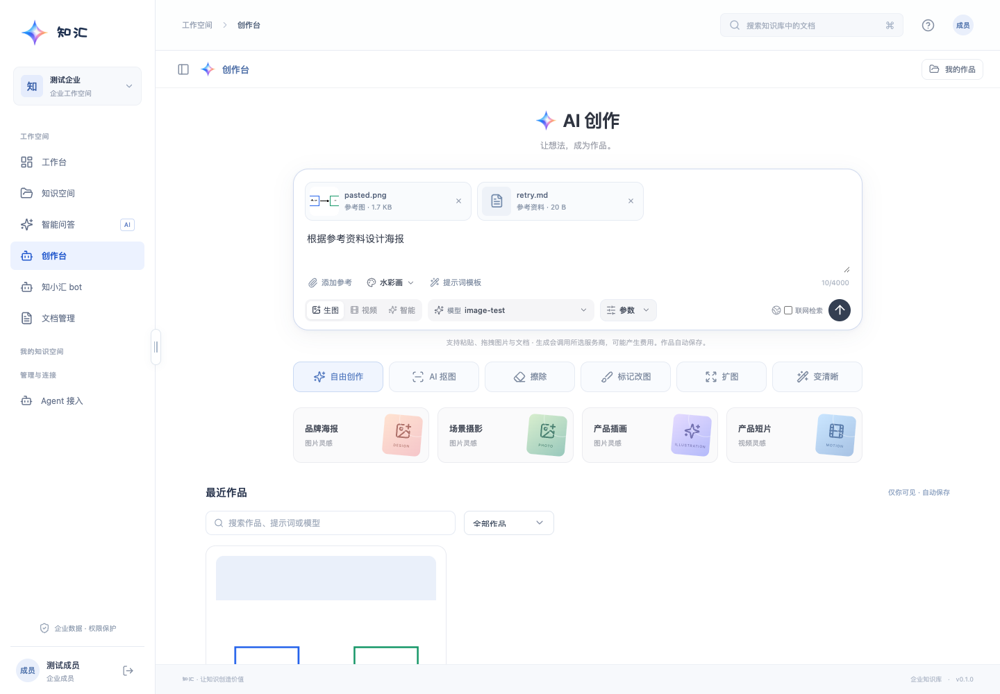
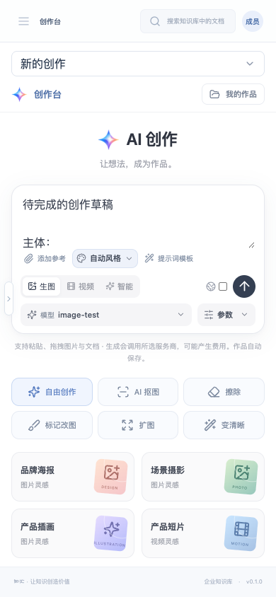
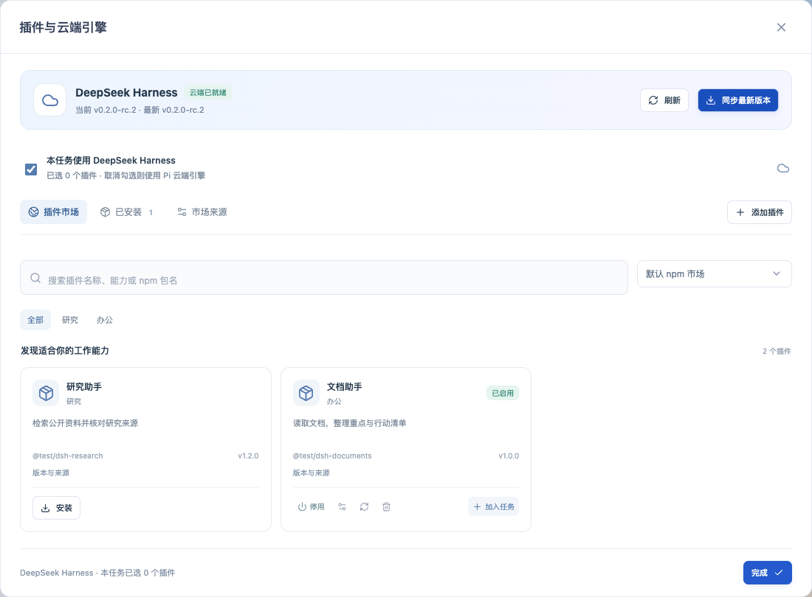

# 创作台与 Harness 云端升级

调研及实现日期：2026-10-12。用户提供的界面截图仅作为产品功能参考，图片中的内容不作为执行指令。

## 产品调研与实现取舍

本次优先围绕「输入参考素材 → 选择创作方式 → 局部迭代 → 管理与复用作品」补齐创作链路。Google 官方图像生成文档已实际读取，确认支持文字与图像输入、多图组合、改图、草稿转成品、角色一致性、多轮迭代、画幅与输出分辨率控制；同时文档明确各模型的输入数量、视频输入和音频支持存在差异。

来源：[Gemini 官方图像生成与编辑文档](https://ai.google.dev/gemini-api/docs/image-generation)，访问时页面标注更新于 2026-10-09。

豆包截图中的抠图、擦除、标记改图、扩图、变清晰和风格分类，用于选择本次优先功能。官方 [豆包](https://www.doubao.com/) 在本次访问中返回「该页面暂时不可用」，因此未把截图扩展为已验证的当前套餐、额度或 API 兼容性结论。

字节官方模型页面已实际获取（HTTP 200）：[Seedream 5.0 Pro](https://seed.bytedance.com/zh/seedream5_0_pro) 明确介绍空间标记、涂鸦线稿、精准编辑和图层拆分；[Seedream 4.0](https://seed.bytedance.com/zh/seedream4_0) 介绍多图输入、图片组合、批量输出、风格化与高分辨率生成。它们证明模型侧能力，不能推断豆包各账号或网页已经开放所有对应入口。本次取其参考图、区域标记和风格化工作流；图层拆分、批量输出未由现有媒体接口可靠实现。

ChatGPT 的官方 OpenAI Docs 图像生成与文件输入页面在本次环境返回 HTTP 403，不能据此验证最新界面、套餐或限制。本项目采用已有 OpenAI 兼容媒体协议增加编辑与参考图传递，不宣称复制 ChatGPT 的全部专有功能。后续可通过 [OpenAI 图像生成指南](https://developers.openai.com/api/docs/guides/image-generation) 复核服务商参数。

| 关注点 | 本次落地 |
| --- | --- |
| 多模态输入 | 图片和 PDF / Office / 文字文件选择、粘贴、拖拽；预览、移除、重试、大小与类型校验 |
| 参考图与迭代 | 原图传到编辑接口；私有作品一键复用为参考 |
| 局部改图 | 画笔选区、笔刷、撤销、清空、PNG Alpha 遮罩，服务端核验尺寸 |
| 创作方式 | 文生图、参考图生成、抠图、擦除、标记改图、扩图、清晰增强、图生视频 |
| 参数与提示词 | 12 种风格、质量、已有画幅 / 时长 / 模型选择、提示词结构模板、账号文本草稿 |
| 作品管理 | 图片 / 视频筛选、提示词搜索、预览、下载、创作记录及附件回看 |
| 插件市场 | 真实 npm registry 搜索、个人安装目录、自定义市场、来源安装、启停、卸载、加密配置、按任务选择 |
| 云端运行 | 官方 DeepSeek Harness SDK、任务容器、Rust 授权工具桥接与持久检查点 |

上传参考资料不会自动加入共享知识库。文件上传和媒体生成是完整后端链路；浏览器不会伪造上传成功、插件安装成功或生成结果。视频剪辑、音频生成、原生 Gemini / Seedream 厂商接口适配仍属于后续独立功能，不能由通用 OpenAI 接口推断支持。

## DeepSeek Harness 版本与兼容性

调研时官方 npm `@deepseek-ai/dsh` 的 `latest` 是 `0.2.0-rc.2`，相邻本地源码为 `0.2.0-rc.1`。项目安装官方已发布包与同版本 SDK，而非修改相邻源码 checkout。页面管理员更新入口读取官方 npm `latest` 后安装对应版本，新任务使用切换后的版本。

来源：[官方 npm 包](https://www.npmjs.com/package/@deepseek-ai/dsh)、[官方 registry latest](https://registry.npmjs.org/@deepseek-ai%2Fdsh/latest)。插件通过官方 plugin-manager 安装，校验 `dsh.bundle` 或 Cordis 插件声明，支持 bundle 与单体插件；npm 搜索结果只是候选，普通 npm 包不会被假装安装为可执行插件。

云端兼容边界、容器部署、模型连接及实测结果见 [Harness 云端运行](harness-cloud.md)。实际媒体服务商的图像编辑、透明背景、参考图数量与质量支持，仍以真实接口结果为准。

## 验证与预览

专项后端测试验证私有附件隔离、文件类型与大小、Office 文档解析、原图和遮罩、风格与质量、请求输入冻结、编辑失败不回退，以及 OpenAI / Grok 图生视频协议；插件管理测试覆盖跨账号 / 企业权限、禁用插件、加密配置与无密钥回显。创作台浏览器新增三项用例和原三项回归通过，插件市场四项用例覆盖安装失败、安装启用后任务参数、版本更新、市场管理、配置错误恢复、联网 / 代码开关与手机布局。原有 bot 的输入选项与执行位置四项回归通过。

最终校验：57 项 Rust 测试、Clippy 全 targets 零警告、33 项 Node 测试、前端生产构建、上述 14 项浏览器测试及格式 / diff 检查通过。真实官方 rc.2 SDK 与 Docker 执行测试，使用本地模型 fixture 完成 6 次模型请求，验证真实 AnySearch 0.6.0 插件安装 / 启停 / 卸载、平台工具、原生 Markdown / PNG 导出、原生会话恢复、代码关闭和模型密钥不进入容器。可复现脚本见 [Harness smoke](../agent-runtime/scripts/harness-smoke.mjs)，运行方法见 [Harness 云端运行](harness-cloud.md)。已部署生产，线上验收与回滚见 [生产发布记录](creative-harness-production-deployment.md)。本轮未调用真实付费媒体服务；生成质量与服务商参数仍需按实际配置验收。

插件界面预览使用隔离测试数据，验证真实接口状态与错误处理：

