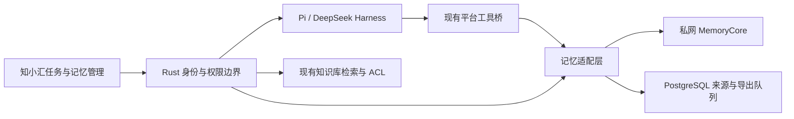

# TencentDB Agent Memory 调研与知小汇接入建议

调研日期：2026-10-12（Asia/Shanghai）。上游：[TencentCloud/TencentDB-Agent-Memory](https://github.com/TencentCloud/TencentDB-Agent-Memory)。

源码基线：默认分支 `feat/server_team`，提交 `274e549069ad780e411d70e6fff51f6a977d81d3`（2026-10-10）。GitHub 最新非预发布 Release 为 [v2.0.2](https://github.com/TencentCloud/TencentDB-Agent-Memory/releases/tag/v2.0.2)，发布于 2026-10-09；本文分析的是该提交快照，未验证 Release 镜像与源码完全一致。

本地基线：知小汇当前工作区，包含尚未提交的 Harness 云端及插件实现。本文新增调研材料，没有接入生产或改动业务逻辑。

## 1. 结论

**值得接入验证，最适合补齐知小汇的跨任务记忆和经验沉淀。推荐把 MemoryCore 作为可替换的内部记忆后端，由 Rust 统一封装，通过现有工具桥服务 Pi 和 DeepSeek Harness。**

现有 harness 已有任务笔记、上下文压缩、检查点、原生会话恢复、工具回执和操作确认。真正的缺口是：新任务如何继承用户偏好、历史约定和成功工作方法，并允许用户查看、纠正、撤回这些记忆。

建议优先级：个人跨任务记忆 → 经审核的可复用技能 → 项目/团队经验。Wiki、CodeGraph 和完整 Memory Hub 暂缓，待明确独立需求再引入。

当前判断是“适合 PoC”，尚不能认定为可以直接替换现有基础设施的企业级记忆服务。关键原因包括：数据面不做用户级鉴权；L2/L3 聚合粒度与我们的个人助手不同；默认部署存在隔离开关；公开源码的云端 service 模式依赖缺失的部署适配；实际效果、负载和成本尚未验证。

## 2. 它提供什么

| 模块 | 职责 | 对知小汇的价值 | 建议 |
| --- | --- | --- | --- |
| MemoryCore | L0–L3 记忆、抽取/去重、召回、Skill、资产元数据 | 长期偏好、历史决策、方法沉淀 | 首期接入 |
| MemoryProxy | 代理模型请求、识别会话、注入记忆、捕获对话/工具过程 | 多种 Agent 的快速接入 | 独立实验可用；正式方案先用 API |
| MemoryPanel / Hub | 团队、用户、Agent、资产审核/分享/绑定 | 可借鉴“我的记忆”和技能治理 | 初期用作内部观察；用户界面留在知小汇 |
| MemoryKnowledge | Wiki 生成/链接、CodeGraph、知识工具 | 文档关系和代码影响分析 | 后续按场景评估 |

MemoryCore 不执行 Agent loop。它提供记忆服务，不能代替计划、工具执行、权限、审批、任务恢复或评测。[上游模块说明](https://github.com/TencentCloud/TencentDB-Agent-Memory/blob/274e549069ad780e411d70e6fff51f6a977d81d3/MemoryCore/README_CN.md)

| 记忆层 | 内容 | 典型用途 |
| --- | --- | --- |
| L0 Conversation | 用户和助手原始对话 | 回看原话和历史上下文 |
| L1 Atom | 抽取的事实、偏好、约束、事件 | 按问题召回具体信息 |
| L2 Scenario | 按场景组织的记忆文件 | 恢复项目或工作语境 |
| L3 Persona / Core | 长期画像和高层概括 | 继承稳定偏好 |
| Skill | 工作方法、版本和资源文件 | 复用已验证流程 |

源码包含异步抽取、冲突检测、去重以及生成来源日志；这说明它不只是聊天存储。不过抽取结果仍是模型生成的数据，正确性需要产品治理和实际评测。

## 3. 对照知小汇现状

| 当前能力 | 代码入口 | 已解决的问题 | 尚缺的部分 |
| --- | --- | --- | --- |
| `task_memory` | `backend/src/bot.rs:1151` | 当前任务的 findings、refs、缺口和下一步；回执进入加密工具日志 | 没有独立长期记忆索引；`verified` 是模型自报 |
| Pi context harness | `agent-runtime/harness.mjs:104`、`:252` | 恢复笔记、证据 ledger、压缩上下文 | ledger 限定在当前任务 |
| `runtime_recall` | `backend/src/bot.rs:357` | 按当前 task_id 回读完整工具结果 | 无跨任务语义检索 |
| checkpoint / journal | `backend/src/bot.rs:180`、`backend/src/agent.rs:581` | 持久恢复、租约、防重复执行、权限复查 | 运行状态不等于长期经验 |
| DSH session persistence | `agent-runtime/harness-sdk-server.mjs:17` | 同一 task_id 原生会话恢复 | 新任务没有统一的长期记忆装配 |
| 继续对话 | `backend/src/bot.rs:1503` | 继承直接 parent 的提示、答案、成果与引用 | 不递归继承完整历史笔记和工具日志 |
| 账户云端目录 | `agent-runtime/harness-cloud.mjs:113` | 用户自己的旧文件可持久保存 | 缺统一召回、有效性管理与遗忘机制 |

因此，MemoryCore 的增量主要发生在“任务与任务之间”。原来的 `task_memory`、`runtime_recall`、checkpoint 和 DSH 原生 session 继续承担各自职责。

落到产品上，最有价值的三个场景是：

1. **减少重复交代**：用户要求“研究报告先给结论，列来源和未核实项”，后续新任务自动遵循，也能在“我的记忆”修改。
2. **继承项目约定**：再次做场站月报时，记得此前约定的口径、输出模板和常见坑；具体指标仍查询当前授权资料。
3. **复用成功方法**：将一次跑通的报表分析或会议纪要流程提炼为候选 Skill，经审核后纳入知小汇的可选工作流。

这三个场景应分别评测。记住格式偏好，不代表已经具备可靠的项目事实和团队技能复用。

## 4. 接入路线比较

| 路线 | 工作量 | 适配性 | 主要代价 | 判断 |
| --- | --- | --- | --- | --- |
| 模型 Base URL 改为 MemoryProxy | 独立客户端较低 | 对知小汇当前 DSH 路径不直接兼容 | 进入模型主链路；身份、流式、归档和协议适配耦合 | 用于实验 |
| 安装上游 Pi 插件 | Pi coding-agent CLI 较低 | 我们用 Pi Agent Core，自行构造 loop | 插件依赖 coding-agent ExtensionAPI 和 sessionManager | 参考实现 |
| Rust 调用 MemoryCore HTTP API | 中等 | 两个引擎共用现有平台工具 | 自己实现身份、召回装配、捕获、预算和治理 | **推荐** |
| 同时引入 Hub / Wiki / CodeGraph | 高 | 功能多但重叠大 | 重复用户、团队、知识索引和权限体系 | 后续独立评估 |

### 为什么“支持 DSH”不等于知小汇只需改 URL

知小汇当前 DSH 使用 `llm-pi-ai` 的 OpenAI `atlas` provider，模型通过临时任务桥接回平台，真实供应商密钥留在 API/worker（`agent-runtime/harness-agent.mjs:328`、`:430`）。

上游 DSH Proxy 指南依赖 `deepseek-api-key` adapter 的 `x-deepseek-harness-*` 会话头；其指南明确记录自定义 `llm-pi-ai` adapter 缺这些头，session-init 流程不能正常工作。[DSH 接入指南](https://github.com/TencentCloud/TencentDB-Agent-Memory/blob/274e549069ad780e411d70e6fff51f6a977d81d3/agents/dsh/README.md#L153)

上游 Pi 插件也是 provider 路由扩展，所有记忆能力由 Proxy 提供，且部分模型窗口参数写死。它不是可直接装进我们 Pi Agent Core loop 的通用 memory hook。[Pi 插件源码](https://github.com/TencentCloud/TencentDB-Agent-Memory/blob/274e549069ad780e411d70e6fff51f6a977d81d3/MemoryCore/pi-plugin/index.ts#L47)

## 5. 推荐架构和生命周期

建议接口分成三类：

- **自动召回**：任务启动前，召回同一用户相关偏好/经验，加入有时间、来源和预算的历史上下文；无有效记忆时直接继续。
- **按需查询**：新增原生 `memory_search` 工具，经现有平台工具桥查询。模型只提交 query / limit，不提交 tenant、user、agent 或任意外部路径。
- **沉淀与管理**：任务完成后异步产生候选记忆；明确“记住这件事”可走 `memory_propose`。用户通过产品界面查看、纠正、删除和分享。首期不把外部数据面的任意写入能力交给模型。

建议的运行顺序：

1. Rust 根据登录身份、任务选项和记忆设置，构造可信的隔离上下文。
2. 启动时查询长期记忆；历史记忆作为数据块处理，不能覆盖当前用户要求或获得额外工具权限。
3. 执行中继续使用 `task_memory` 保存当前证据；`memory_search` 只补相关历史。
4. 任务成功完成后，在同一业务事务中写本地 outbox，worker 筛选并脱敏后导出。失败、中断、等待外部确认的结果不被自动认定为成功经验。
5. 记忆服务不可用时主任务继续运行；导出失败保留可观察的队列状态。运行恢复仍由现有 checkpoint/session 负责。

首版建议自动装配上限 1,500–2,000 tokens、搜索返回不超过 5 条、召回总超时约 2 秒。这是待验证的起始参数，不是上游性能承诺。应记录注入量、耗时、命中率和用户纠正率，避免记忆反而占满上下文。

### 身份映射必须覆盖 L2/L3 的聚合语义

**上游 L2/L3 地址只使用 team + agent，忽略 user、session、task。** 同一企业如果所有用户都用 `agent_id=zhixiaohui`，不同用户的画像和场景会聚合。纯函数探针已复现这一点。[profile-scope.ts](https://github.com/TencentCloud/TencentDB-Agent-Memory/blob/274e549069ad780e411d70e6fff51f6a977d81d3/MemoryCore/src/core/profile/profile-scope.ts#L34)

| 字段 | 推荐映射 | 注意事项 |
| --- | --- | --- |
| service_id | 配置中的实例 ID；多实例部署时可对应 tenant | standalone 下不能仅靠它假定所有文件完全隔离 |
| team_id | 全局唯一的 tenant 映射 ID | 部门 ACL 仍由知小汇处理 |
| user_id | 当前用户的稳定映射 ID | 服务端注入 |
| agent_id | 全局唯一的 tenant + user + 记忆用途 ID | 同一用户在 Pi/DSH 间复用；不用引擎名、容器 ID 或 task_id |
| session_id | 来源任务/对话 ID | 写入必填，保证回合边界 |
| task_id | 来源工作项 ID | 写入记录来源；跨任务召回通常不带当前 task_id |

个人画像、项目语境和团队经验应使用不同的记忆空间或 agent。L2/L3 也忽略 task_id，因此只加 project/task 字段不足以防止多个项目在同一个画像里混合。

团队共享采用显式审核、独立共享身份/资产和授权绑定。不能通过取消个人过滤条件“顺便”实现团队召回。

首次启用时还需通过内部管理接口创建/关联上游 Team、User、Agent，保存返回 ID 的映射，设置正确的 agent owner。仅在数据面填写一组自造 ID，不等于这些管理实体已经存在；自动 chat-memory 资产登记找不到 Agent 时只记录 warning，对话仍可能写入，容易出现“有内容但无法管理/清理”的不一致。[资产登记实现](https://github.com/TencentCloud/TencentDB-Agent-Memory/blob/274e549069ad780e411d70e6fff51f6a977d81d3/MemoryCore/src/metadata/service/metadata-service.ts#L1381)

### 公开 API 可以做，但有两条不同写入链

| 用途 | 已确认入口 | 实际行为 |
| --- | --- | --- |
| 对话沉淀 | `POST /v3/conversation/add` | 写 L0，再异步通知记忆 pipeline；不会自动提炼 Skill |
| 跨会话记忆搜索 | `POST /v3/atomic/search` | 可按 team/user/agent/task 过滤；L1 搜索不带 session 过滤 |
| 原对话搜索 | `POST /v3/conversation/search` | 召回 L0；个人范围由后端固定 |
| 场景与画像 | `/v3/scenario/ls`、`/read`、`/v3/core/read` | 需要我们自己装配上下文和管理预算 |
| 工具过程沉淀 | `POST /v3/skill/conversation/add` | 独立的 Skill 缓冲/归档/抽取链 |
| Skill 查询 | `/v3/skill/search`、`/get` | 候选内容经平台治理后才进入用户选用的流程 |
| 全层记忆清理 | `/v3/chat-memory/clear` | 有分项状态和失败结果；不应只看 HTTP 200 |

接口适配需要处理：

- L0 只接受 user/assistant，两种角色的正文每条最多 8,192 字符、每次最多 100 条。不要直接上传完整工具日志或私密推理。[schema](https://github.com/TencentCloud/TencentDB-Agent-Memory/blob/274e549069ad780e411d70e6fff51f6a977d81d3/MemoryCore/src/gateway/generated/schemas.ts#L82)
- Skill 增量接口支持五种角色，包括 tool_call/tool_result，每次最多 500 条；保留工具 ID 配对、名称及真实结果。这条链需在完整回合结束后另行调用。[skill schema](https://github.com/TencentCloud/TencentDB-Agent-Memory/blob/274e549069ad780e411d70e6fff51f6a977d81d3/MemoryCore/src/gateway/skill-schemas.ts#L263)
- L0 写入每次生成新的消息 UUID，调用方的业务 message ID 没有幂等效力。outbox 需要唯一事件键，但网络超时后“服务端已写、客户端未收到”的重复窗口仍需通过上游幂等扩展或对账消除，不能宣称本地去重就能 exactly-once。[handler](https://github.com/TencentCloud/TencentDB-Agent-Memory/blob/274e549069ad780e411d70e6fff51f6a977d81d3/MemoryCore/src/gateway/v2-router.ts#L718)
- 旧 README 中有 `/v2/atomic/add`，当前数据面路由表没有它。新增记忆应从 conversation/add 进入抽取链，不能照旧文档拼写入接口。[路由表](https://github.com/TencentCloud/TencentDB-Agent-Memory/blob/274e549069ad780e411d70e6fff51f6a977d81d3/MemoryCore/src/gateway/v2-router.ts#L413)
- API 采用 `{code,message,request_id,data}` 信封；部分 Skill 错误采用五位业务 code，HTTP 200 也可能是失败。适配层需要同时检查 HTTP 与业务 code。
- pipeline 是异步的：写入 accepted 不代表 L1/L2/L3 已就绪，Skill 入队也不代表已经形成正确的流程。

## 6. 需要解决的成熟度和权限边界

### 6.1 鉴权和隔离不能交给上游默认配置

上游 SDK 明确说明：L0–L3 数据面和 clearChatMemory 不需要 userKey，内核不做用户级鉴权。传 user_id 是寻址，不能证明调用者就是该用户。[SDK 类型说明](https://github.com/TencentCloud/TencentDB-Agent-Memory/blob/274e549069ad780e411d70e6fff51f6a977d81d3/sdk/memory-core/typescript/src/v3/types.ts#L34)

默认启动配置关闭 Core Bearer gate，文档还说明 Proxy 部分调用当前不发送该凭证；`V3_STRICT_ISOLATION` 运行默认也关闭。纯函数 `assertIsolation({})` 即使收到 enforce=true，也实际填充 default ID，而不是按注释抛错。[部署默认值](https://github.com/TencentCloud/TencentDB-Agent-Memory/blob/274e549069ad780e411d70e6fff51f6a977d81d3/deploy/global-images/.env.example#L103)、[路由开关](https://github.com/TencentCloud/TencentDB-Agent-Memory/blob/274e549069ad780e411d70e6fff51f6a977d81d3/MemoryCore/src/gateway/server.ts#L1023)、[隔离 helper](https://github.com/TencentCloud/TencentDB-Agent-Memory/blob/274e549069ad780e411d70e6fff51f6a977d81d3/MemoryCore/src/core/store/isolation.ts#L73)

正式方案应只允许 API/worker 在私网访问 Core；配置非空网关凭证及严格隔离，并在 Rust 额外拒绝缺失/非法身份。浏览器、任务 shell 和第三方插件只使用平台短时任务 token。不能把 Core 管理凭证下发给它们。

MemoryKnowledge 的 tools/list、tools/call 和部分内容读取接口，即使配置 service key，仍属于开放的只读白名单。未来引入它时，也必须经过平台当前 ACL；上游 Panel 的 private/team/restricted 不能被视为数据面全链路保护。[Knowledge auth](https://github.com/TencentCloud/TencentDB-Agent-Memory/blob/274e549069ad780e411d70e6fff51f6a977d81d3/MemoryKnowledge/src/middleware/auth.ts#L50)

### 6.2 历史记忆会绕过“后来撤销的文档权限”，需要来源治理

当前 `task_memory.refs` 的 `[1]` 只是任务内编号。跨任务沉淀时，必须解析为 source_task_id、call_id、document_id、chunk_id、space_id 和文档版本，并在每次使用时复查当前权限。

上游抽取过程中有 `source_message_ids` 和生成日志，但当前 atomic/query 返回对象不包含完整文档来源；SQLite L1 reader 重建 `source_message_ids` 时为 `[]`。这不足以证明可直接继承我们现有文档级 ACL。[atomic 返回构造](https://github.com/TencentCloud/TencentDB-Agent-Memory/blob/274e549069ad780e411d70e6fff51f6a977d81d3/MemoryCore/src/gateway/v2-router.ts#L1144)、[L1 reader](https://github.com/TencentCloud/TencentDB-Agent-Memory/blob/274e549069ad780e411d70e6fff51f6a977d81d3/MemoryCore/src/core/record/l1-reader.ts#L74)

尤其 L2/L3 会聚合多个任务，单纯给导出事件加来源表，并不能自动解决合并后摘要的撤权和清理。首期只导出用户明确表达的偏好/约定，用合成数据验证。企业文档事实进入长期记忆前，需要建立可追溯派生关系、过期/撤权失效与重新生成机制；无法追踪来源的企业事实不自动注入。

记忆的 `verified`、来源日志和生成成功状态均不代表事实认证。发生冲突时以当前用户要求和当前授权资料为准。

### 6.3 删除会话不等于遗忘

`conversation/delete` 只删除 L0，不会联动删除已经抽取的 L1/L2/L3；删除资产或 Agent 的元数据也不一定删除内容。已有 chat-memory/clear 和 archiveAgent 清理路径，但“忘记我”必须协调所有层、Skill、缓存、导出队列、生成日志、备份保留策略，并检查分项清理结果。[L0 删除实现](https://github.com/TencentCloud/TencentDB-Agent-Memory/blob/274e549069ad780e411d70e6fff51f6a977d81d3/MemoryCore/src/gateway/v2-router.ts#L1022)、[全层清理 API](https://github.com/TencentCloud/TencentDB-Agent-Memory/blob/274e549069ad780e411d70e6fff51f6a977d81d3/MemoryCore/v3-api-memorycore-doc.md)

删除请求还应先标记平台 tombstone，立即停止召回和再次导出，避免异步 pipeline 或 outbox 把已删内容重新生成。

### 6.4 自托管可行，但云端多副本模式不能按文档直接承诺

- 根 LICENSE 是完整 MIT，可用于商业产品，需保留版权和许可文本。GitHub API 的 NOASSERTION 是识别结果，不能代替实际许可文件。
- 开源 standalone 可使用 SQLite、本地文件和本地队列，不需要购买腾讯云服务。
- SQLite + sqlite-vec 可支持向量能力，但默认 global-images 脚本配置 `embedding.provider: none`；不能把默认部署当成已启用 hybrid 向量召回。[生成配置](https://github.com/TencentCloud/TencentDB-Agent-Memory/blob/274e549069ad780e411d70e6fff51f6a977d81d3/deploy/global-images/start-memory-core.sh#L171)
- MongoDB 是实验功能，需要带 mongot 的部署；当前 Mongo store 的向量搜索未实现。它不能被当成现有 PostgreSQL/Qdrant 的等价替代。
- `deployMode=service` 需要 `src/integrations/` 私有部署适配；当前公开 checkout 缺失该目录，启动代码会明确报错。TCVDB/COS/Redis 的云端部署说明不等于公开源码已包含完整可运行方案。[启动实现](https://github.com/TencentCloud/TencentDB-Agent-Memory/blob/274e549069ad780e411d70e6fff51f6a977d81d3/MemoryCore/src/gateway/server.ts#L1850)
- standalone 中 L0/L1 可按 service_id 分库，但本地文件 storage 仍共用 baseDir，L2/L3 scope 不含 service_id。所有 team/agent ID 应在服务实例间全局唯一；企业隔离 PoC 必须覆盖这一点。[文件 storage](https://github.com/TencentCloud/TencentDB-Agent-Memory/blob/274e549069ad780e411d70e6fff51f6a977d81d3/MemoryCore/src/gateway/server.ts#L2674)

首期推荐一个受控的 standalone 实例、持久卷、固定版本、有限用户和脱敏/合成数据。正式多企业并发上线前，再决定独立实例隔离、扩展上游公开存储适配，还是采用其他记忆后端。不要默认它能直接复用知小汇现有 PostgreSQL、Qdrant 和 MinIO；上游没有对应的现成组合适配。

### 6.5 维护和效果证据

项目从 2026-04 创建，当前活跃更新。Release、README、API 名称和实现存在漂移，默认分支也是功能分支。接入时应锁 commit/镜像 digest，通过回归再升级。

公开快照包含 Vitest 配置、测试合约定义和 fake store，但未找到配置所匹配的可执行 `*.test.ts` / `*.spec.ts` 套件；公开 CI 主要检查安装、打包、manifest、体积和代码边界，没有执行 Vitest。不能据此认定内部没有测试，但我们无法确认完整的公开回归保障。[CI](https://github.com/TencentCloud/TencentDB-Agent-Memory/blob/274e549069ad780e411d70e6fff51f6a977d81d3/.github/workflows/pr-ci.yml)

README 宣称 PersonaMem 从 48% 到 76%：是增加 28 个百分点、约 59% 相对提升。此次未复现其 benchmark，公开快照未找到充分的完整复现实验材料；更不能推导出知小汇任务成功率或成本有同等改善。

额外成本来自 L1 抽取/冲突判断、L2/L3 总结、Skill 提炼以及召回内容增加的模型输入。默认脚本的记忆提示词为 code，纯聊天可能不抽取偏好；个人偏好 PoC 应评估 chat 模式或受控自定义策略。[默认模式](https://github.com/TencentCloud/TencentDB-Agent-Memory/blob/274e549069ad780e411d70e6fff51f6a977d81d3/deploy/global-images/.env.example#L125)

## 7. 可执行的分期计划

### P0：验证个人跨任务记忆

范围：测试租户、小范围用户、合成或明确选择的偏好数据，Pi 和 DSH 各走一遍；不导出真实企业全文。

1. 准备私网 standalone MemoryCore，开启凭证和严格隔离，锁版本；用独立持久卷验证备份恢复。
2. 新增 `backend/src/bot_memory.rs` HTTP adapter，统一响应信封、身份注入、超时、配额与故障降级。
3. 新增本地身份映射和 outbox；记录 source_task、event_key、payload_hash、上游 accepted_ids、状态/重试，不把模型凭据带入任务容器。
4. 在任务构造阶段预取记忆；在 `agent-runtime/platform-tools.mjs` 注册 `memory_search`，在 `backend/src/agent.rs` 和 `backend/src/bot.rs` 接入已有分派。
5. 在任务完成事务附近写导出事件；仅输出选定的用户偏好/约定，异步经 conversation/add 生成记忆。
6. 提供最小的查看/禁用/删除管理能力，记录自动召回与导出状态。

现有 DSH 的 `harness-plugin.mjs` 按共享 schema 注册工具，`harness-agent.mjs` 生成白名单后桥接回 Rust，因此这条路径可以同时服务两个引擎；不需要分别安装上游插件。

P0 验收必须包括：

| 场景 | 通过标准 |
| --- | --- |
| 用户 A 新建任务 | 能召回旧任务中选定的格式偏好/约定，且展示来源 |
| 用户 B 和另一企业 | 无法读到 A 的记忆，包括 L2/L3 |
| 切换 Pi / DSH | 同一用户复用同一记忆身份，任务恢复仍正确 |
| 新指令与旧偏好冲突 | 当前明确指令优先，旧记忆可纠正 |
| 服务断开 | 任务继续执行，checkpoint/session 恢复不依赖 MemoryCore |
| 重复投递/响应丢失 | 重复窗口被检测或对账，不无限重复沉淀 |
| 删除/禁用记忆 | 停止召回；队列和派生层不会重新生成已删除内容 |
| 历史外部操作 | 记忆不能触发旧连接器写入、绕过审批或重放副作用 |

### P1：候选技能沉淀与审核

将已完成任务的完整、脱敏工具过程另送 skill/conversation/add；候选 Skill 展示出处、适用范围、版本和验证结果。审核后再加入现有 builtin_skills/用户可选工作流，团队分享作为明确操作。

自动生成的 Skill 不能默认执行安装脚本、扩大联网/代码权限、设置定时任务或发外部消息。权限继续来自当前任务和平台。

### P2：项目/团队经验与知识关系

先解决来源追踪、撤权、聚合摘要重建、项目边界、共享审核与组织身份同步，再扩大到企业知识事实。Wiki 只导入明确授权的资产子集，避免第二套全文知识库失去版本和 ACL 一致性；CodeGraph 优先针对真正需要代码影响分析的场景。

粗略工程量：P0 技术 PoC 约 3–5 个工程日；可试用的记忆管理、删除/幂等补齐、集成测试和观测约再 5–10 个工程日。此为单个熟悉当前代码的工程师的初估，未包含多副本存储适配、真实负载优化或完整项目事实撤权。上游接口兼容性问题可能增加时间。

## 8. 评测和选型决策

建立 30–50 组贴近知小汇的任务对，比较三个条件：现有 harness、简单 PostgreSQL 偏好/笔记方案、TencentDB Agent Memory。使用相同模型和任务资料，单独记录抽取成本。

评测维度：偏好继承正确率、历史约定召回、错误/过期记忆使用率、跨用户/租户泄漏、来源权限撤销、重复提问和工具调用次数、端到端耗时、总 token/模型费用、用户纠正与删除成功率。

所有隔离、权限、删除、故障降级场景通过后，再看是否明显减少重复交代和重复检索。如果需求仅是少量固定偏好，现有 PostgreSQL 增加可治理的偏好表可能更便宜；如果多轮经验抽取、场景恢复和 Skill 复用确有收益，MemoryCore 的投入更有价值。适配层应保留这一替换空间。

知小汇 harness 的下一步可以明确为：**已有可靠执行与恢复 → 补齐长期记忆 → 用实际任务评测收益 → 再扩展团队经验。**

## 9. 本次验证范围

已完成：拉取公开源码、核对 GitHub 仓库/Release 元信息、对照本地当前实现、检查 API/schema/处理函数和默认部署配置；在 Node 22.23.1 中直接运行两组上游纯函数探针，确认缺失隔离字段填 default，以及不同用户共用 team/agent 时 L2/L3 scope 相同。

未完成：启动完整上游服务、真实 LLM 抽取/召回、Pi/DSH 端到端接入、压测、PersonaMem 复现、Release 镜像一致性验证和完整安全审计。因此本文中的运行链路、部署边界以源码核查为依据，产品效果和生产性能需由 P0 验证。

公开元信息与探针结果保存在 [调研证据](tencentdb-agent-memory-research-evidence.json)。
