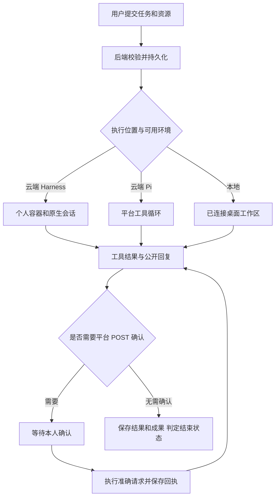

# 知小汇 bot 执行逻辑与功能评审

整理日期：2026 年 10 月 13 日。用途：核对当前行为，判断下一步如何改进任务执行逻辑。

本报告依据当前工作区的前后端代码、运行时及近期部署记录整理，包含工作区尚未提交的实现。本次进行代码核对，没有操作生产任务或重新验收第三方服务。正文中的“当前行为”指代码实现；生产状态单独注明记录日期。

知小汇目前已经具备持久任务、授权资料检索、工具执行、成果保存和跨设备查看能力。评审时最需要关注的是三种执行路径的策略差异，以及“执行结束”“成果已交付”“外部操作成功”之间尚未统一的判断规则。

可以先读第 1 节理解执行路径，再读第 8 节判断改进优先级；第 2 至 7 节说明具体流程与功能，第 10 节提供限制和代码依据。

## 1 总体执行方式

网页负责接收任务和展示结果；Rust 后端负责账号权限、任务队列、工具授权、外部操作确认及成果保存；Agent 决定下一步调用什么工具。模型可以提出操作，但平台工具仍由后端核验并执行。[S1][S2]

| 执行路径 | 如何进入 | 使用的模型和环境 | 主要差异 |
| --- | --- | --- | --- |
| Harness 云端 | 新任务选择云端，且云端服务可用时，网页自动选择 | 企业问答模型；个人 Docker 云端电脑；官方 DeepSeek Harness | 原生文件、命令、插件和会话；结束后导入工作目录成果 |
| Pi 云端兼容路径 | 云端服务不可用且未选云端插件时，网页提交 Pi；后端未指定执行器时也走此路径 | 企业问答模型；独立 Node 子进程；平台工具 | 平台自建压缩、检查点、无进展纠偏和执行时间片 |
| Harness 本地设备 | 用户选择已连接电脑和工作区 | 桌面端配置的模型、工具和审批；本机工作区 | 桌面端执行，平台接收公开回复、步骤和主动上传的成果 |

云端插件必须使用 Harness；已指定 Harness 的任务执行失败时，不会在运行中悄悄改用 Pi。本地任务不进入云端 Worker 队列领取逻辑。[S1][S2][S3]

没有启用 Agent 或问答模型时，云端退回真实的原文检索模式，保存检索报告，并提示无法执行智能分析及自动工具操作。界面使用 Harness，不代表模型提供商必须是 DeepSeek。[S2]

## 2 一个任务如何执行

### 收集目标和资源

用户输入任务，可选择授权资料、工作流技能、应用连接器、云端插件和 Wiki 或 CodeGraph 资产；同时设置执行位置、联网、代码执行和个人记忆。Bot 的资料入口选择的是已经索引的知识库文档，上传按钮进入平台共用上传流程，索引完成后才能作为资料使用。首次打开时联网和代码执行默认关闭；研究、会议和分析快捷入口只填入提示词和技能，不直接运行。[S1][S4]

后端要求任务描述为 1 至 6000 字，最多选择 10 份资料、5 个技能、10 个连接器。提交使用请求 ID 去重，同一请求重复到达不会再创建任务。技能说明由后端重新读取并保存快照，不能由浏览器自行伪造。[S2]

选择本地执行时，网页关闭平台联网和代码选项，清空平台连接器及云端插件。这些选项不控制桌面端已有的原生工具；桌面端权限和审批仍由本地客户端决定。[S1][S3]

### 校验并进入队列

后端检查账号、资料版本和权限、技能及连接器归属、知识资产和插件是否可用。每个用户最多保留 10 个处于排队、运行或等待确认状态的任务；暂停和失败不计入这个数。[S2]

任务先持久化为 queued。云端 Worker 原子领取任务、分配执行令牌并续租，转为 running。当前每个启动 Worker 的进程只有一个 Bot 执行循环，逐个处理任务；共享的 4 个 Agent 并发名额还供问答和创作台使用，不能理解为单个 Bot Worker 同时处理 4 个任务。[S2][S5]

### 构建云端任务上下文

云端模型收到任务目标、平台规则、所选技能快照、可用工具目录及允许使用的历史。本地会话使用桌面端的上下文和工具设置，不能套用云端完整目录。

- 已选择资料时，先检索这些资料；未选择资料且 Agent 已启用时，不预先塞入整库搜索结果，由 Agent 按需要检索当前账号可访问的知识库。
- 继续对话时，云端先加入直接上一轮的任务和最终回复、成果文件目录及引用依赖；完整文件按需读取。网页可以恢复更早的多轮对话展示，但展示出来的历史不等于全部原文已经进入模型。
- 启用个人记忆时，任务开始会尝试召回最多 5 条相关记忆。个人全局设置关闭时，单任务开关不能重新启用。
- 恢复中断任务时，重新核对当前身份、权限和工具范围，复用检查点和已完成工具回执。[S2][S6]

### 执行工具循环

平台提示要求 Agent 先发布简洁计划，取材后记录事实和出处，取得足够证据后进入分析、写作和成果复核。Agent 再按结果继续选工具，直到执行器结束、等待审批、暂停、失败或取消。[S2]

这里要区分提示和强制规则：计划更新、事实笔记、文件交付主要由模型按提示完成；后端强制检查的是身份、授权、参数、执行令牌和平台操作范围。当前没有统一的任务类型识别或交付要求表，也没有提交前必须由用户确认计划的固定阶段。

简化流程为：提交目标 → 校验资源 → 持久化排队 → 选择执行路径 → 构建上下文 → 工具循环 → 保存结果并判定状态。

### 结束和交付

Pi 要有完整公开回复；Harness 检查原生结束原因及非空最终回复，再导入工作目录文件。Rust 随后核验当前任务及引用：有待确认的操作则进入 waiting，否则标为 completed；Pi 返回让出执行或暂停时则分别回到 queued 或 paused。[S2][S7]

**当前 completed 表示执行器返回结果且通过已有校验。它没有统一强制要求所有计划步骤已完成、用户要求的文件确实存在、文件经过完整复核，或所有外部写入已有成功回执。** 文档类任务的交付质量仍较依赖模型执行提示。这是后续改进最值得先明确的规则。

## 3 任务状态和后续操作

| 状态 | 含义 | 后续行为 |
| --- | --- | --- |
| queued 排队 | 等待云端领取，或本地设备接收；Pi 时间片让出后也会回到此状态 | 云端自动领取；本地等待设备上线 |
| running 执行中 | 当前执行器正在运行 | 可查看回复、步骤和工具记录，可取消 |
| waiting 等待确认 | 平台外部操作待本人处理；本地也可同步等待提示 | 云端逐项确认或拒绝；本地审批到桌面端处理 |
| paused 暂停 | Pi 纠偏后仍无进展，或执行器同步暂停 | 云端可显式继续；本地到桌面端继续或另建任务 |
| completed 完成 | 当前轮返回结果 | 资料和上下文有效时可继续对话 |
| failed 失败 | 运行、模型、权限或恢复出现错误 | 云端检查记录后重试；本地网页不重放原生操作 |
| cancelled 已取消 | 用户取消，旧执行令牌失效 | 云端可检查后重试；已发出的外部请求不会被撤回 |

“继续对话”会新建关联上一轮的子任务，通常保留上一轮的资源和工具选择，允许用户调整；它不是修改旧任务。只有已完成且资料授权有效的任务允许如此续聊，运行中不能通过输入框追加或修正需求。云端“重试或继续”则恢复同一个失败、取消或暂停任务，可使用旧检查点；手动重试没有统一阻断结果不确定的外部操作，已保存的同一请求指纹负责避免自动重发。网页没有主动暂停按钮，paused 来自运行时或设备同步。[S1][S2]

顶部“新建任务”只清空输入、插件和知识资产等，个人记忆重新设为允许；前一次的资料、技能、连接器、联网、代码和执行设备仍保留。因此“新建”并不代表所有资源与权限选择归零。[S1]

资料更新、删除、撤权以及任务依赖的记忆或知识上下文失效，会影响任务可见性和恢复。已显示给用户或下载到设备的内容无法追回；本地断线期间的执行和取消也需要等连接恢复才能同步。[S2][S3][S6]

## 4 当前各项功能

### 知识资料和公开网络

知识工具可以搜索授权知识库、按文档和页码读取正文、列出可查看空间。检索利用关键词和向量结果，并保留文档版本、页码及引用编号；未选具体文档时范围是当前账号授权资料，选了文档后限定在所选资料中。[S2][S8]

联网由用户任务开关和管理员全局策略共同决定。支持公开网页搜索与正文读取，平台网页读取可以分页，保留公开来源。近期界面把联网开关直接放在输入栏；在允许联网的云端中，新选择明确的搜索或抓取插件会开启联网，用户随后手动关闭的选择受到保留。[S1][S9]

Harness 原生网络工具与平台网络工具可以同时存在。原生工具使用插件的服务，平台工具保留平台来源编号与访问检查。公开网页读取不能代替登录账号、操作浏览器或访问任意内网。联网查询依赖提示约束不发送企业原文，当前没有自动识别敏感信息的过滤器。[S8][S10]

### 技能和插件

四个内置技能分别是深度研究、会议纪要、数据分析、文档写作。技能是任务的工作流说明，可手工创建或导入 Markdown 或 SKILL.md；它不会凭空增加模型、网络或系统权限。每次任务保存所选说明的快照。[S2][S4]

Harness 插件提供实际工具和运行能力，支持 npm 市场搜索、npm 包、GitHub 和公开 HTTPS 压缩包安装，以及启停、配置、卸载和自定义市场来源。插件按个人隔离；已启用还需明确选入任务，最多 20 个，本地任务不能使用这组云端插件。配置加密保存，读取接口不回显原有密钥；替换配置需要提交完整新配置。[S10]

管理员在云端服务设置中手动同步 npm 的最新引擎版本。引擎版本属于整个部署，更新会影响该部署后续新启动的环境；当前没有自动定期升级。[S10]

### 云端电脑和代码执行

Harness 为同一租户和账号复用专属 Docker 容器，每个任务有独立工作目录和会话。连接或运行任务会续期，单纯后台查看状态不会；空闲 30 分钟后由每 60 秒运行的清理循环回收容器。插件、会话、文件及平台数据保持持久化；有正在运行或排队任务时限制断开。[S10][S11]

代码能力分为两种。平台 run_python 是一次性、无网络的 Python 容器，30 秒超时，支持标准库。Harness 原生 shell 和文件工具运行在个人任务容器中，可受任务代码开关控制，能够处理代码及二进制文件；这个容器当前允许出网。[S2][S7][S10]

**联网和代码开关控制已接入的工具目录，不能封锁第三方插件自行联网或运行程序。** 云端 Harness 的原生审批策略也没有逐项人工确认；准确请求审批只覆盖平台通用 POST 连接器。若希望所有副作用都经过审批，需要另外设计插件和原生命令的策略。

### 应用连接器和飞书

通用连接器由用户配置固定 URL、GET 或 POST、参数说明及可选 Bearer 凭据，地址受管理员 host 和 port 白名单约束。GET 将输入变成查询参数并直接请求；POST 将输入作为 JSON，先保存准确 URL、方法和载荷，等本人确认再请求。测试 POST 只校验配置，不实际写入。[S2]

审批采用原子更新、同任务请求指纹去重和幂等键。超时或中断时记录 uncertain，提示用户去外部系统核实，不自动重发。同一请求 ID 的去重和同一任务的指纹不能保证跨不同新任务绝不重复；外部服务是否支持幂等键也需要单独确认。[S2]

飞书提供官方 OAuth 和 PKCE 的一键授权实现，授权后按任务选择，只开放文档搜索、列举、正文读取及用户信息等只读 MCP 工具。平台具备加密令牌保存、刷新、断开和重新授权逻辑。[S12]

**2026 年 10 月 13 日的最新发布记录显示：飞书代码部署通过，真实 OAuth 动态注册返回 invalid_redirect_uri，授权链路未打通。** 因此应表述为“已实现并部署，真实接入待解决”，不能视为目前可正常读取真实飞书文档。本次没有重新测试这个状态。[S13]

### 本地电脑协作

通过 dsh-team 桌面插件连接指定工作区，浏览器完成账号确认；网页也可以发起唤起桌面客户端和连接流程。任务在该工作区的原生会话运行，续聊沿用对应会话，模型和本地工具使用桌面端配置。[S3][S14]

连接会同步所选工作区已有及后续会话，而不只是从网页创建的任务。同步公开用户文本、助手回复及工具名称和状态；隐藏推理、原始工具参数、结果和模型密钥不上传。普通本地文件不会自动扫描导出，要通过平台成果工具主动保存。[S14]

本地平台桥当前仅开放基础知识搜索、读取、空间查询、计划以及成果读写这 6 类工具。个人记忆、技能提议、Wiki 和 CodeGraph 没有进入该白名单；不能按云端的完整工具范围解释本地能力。设备离线时桌面可以继续运行，公开同步及取消指令等连接恢复后再传递。[S3]

## 5 记忆与经验如何工作

当前入口是账号菜单的“个人中心”，再进入“管理记忆与经验”。Bot 页头及已完成任务区域的旧入口已移除。这里需要区分三个不同机制。[S15]

| 机制 | 保存什么 | 如何产生和使用 | 是否跨任务 |
| --- | --- | --- | --- |
| 当前任务笔记和检查点 | 本轮事实、出处、缺口、计划、成果目录和运行消息 | Agent 记录，运行时保存；用于压缩和恢复 | 主要服务当前任务，续聊可继承相关依赖 |
| 个人记忆 | 偏好、约定及经过确认的经验 | 手工录入或 Agent 提议；任务开始和 memory_search 召回 | 是，限本人且受个人设置控制 |
| 沉淀技能 | 可以再次选择的工作流经验 | 从已完成本人任务提炼候选，审核后发布为私有技能 | 是，但需选入新任务 |

个人设置有三个独立开关：跨任务记忆、提取任务经验、技能提炼。代码默认均为开启；这是默认值，具体账号可以有自己的保存设置。跨任务记忆关闭会停止使用，提取任务经验关闭会阻止 Agent 新提议，技能提炼关闭会阻止新的提炼候选创建；关闭不删除既有记录，也不会中止已经提交的提炼。本次任务关闭个人记忆，还会关闭该任务的记忆召回和记忆候选工具；它不等于关闭独立的技能提炼能力。[S6][S15]

个人记忆的 Agent 提议进入待审核草稿，Agent 不能自行批准。手工录入按用户主动确认处理。当前召回主要是平台关键词匹配，偏好和约定有额外权重，尚未采用语义向量召回。腾讯 Core 用于保存已确认的记忆快照及相关经验服务，不能将其描述为所有召回都由腾讯语义检索完成。[S6]

技能提炼需用户在管理界面触发，或由 Agent 对已完成的本人任务提议；不会因为任务完成就自动遍历、提炼全部历史任务。配置腾讯 Core 时可调用其异步提炼，否则使用问答模型生成草稿，没有可用模型时允许手填。Core 候选结果在打开候选列表时刷新。审核后成为私有工作流技能，可以拒绝、撤回或删除。来源授权或版本失效后停用；远程提炼结果不确定时保留回执，等待核对。直接创建自定义文本技能是另一路径，不要求已完成任务，也不受技能提炼开关约束。[S16]

Wiki 绑定已授权且已索引的文档；CodeGraph 当前支持公开 HTTPS GitHub 仓库。用户创建并同步资产后，需要明确选入任务，再使用检索、正文读取、调用关系或影响分析工具。Wiki 原资料更新后旧资产拒绝查询，需要同步重建。腾讯 Knowledge 未配置时，这组远程能力明确不可用；不是自动遍历企业全部资料或支持任意私有代码仓库。[S17]

## 6 长任务推进和中断恢复

### Pi 路径的策略

Pi Bot 已移除旧的固定 8 次模型请求和 16 次工具调用上限，也不套用普通问答的全任务超时。它有以下平台策略。[S18]

- 接近上下文容量时压缩历史，保留原目标、当前规则和完整工具批次。原文和工具回执保存在加密日志中，可分页回读；摘要失败则回退为明确标注缺失的摘录。
- 维护已读范围和证据缓存，重复读取、空结果、换参数但取得相同片段等不会算新增证据；重命名计划不算进展。
- 连续 3 次读取没有新增证据时提醒推进；达到 8 次时进入交付纠偏，暂时收起取材工具，要求先保存有证据边界的草稿。纠偏后仍有 3 轮无进展则暂停，等待用户继续。
- 正常执行默认每 600 秒在完整轮次边界让出 Worker，重新排队并从检查点续接。这是调度时间片，不是到 10 分钟就判失败。

这些阈值服务于无进展识别，不是正常任务的总调用预算。新证据、实际完成计划步骤或保存成果可更新进展状态。事实笔记帮助恢复，但不等于系统保证笔记里的事实正确。

### Harness 和本地路径的差异

Harness 云端使用官方原生会话、循环和上下文压缩，平台同时保存消息、工具回执及恢复信息。**当前 Harness 适配没有接入 Pi 的同一套 3 和 8 次无进展纠偏及 600 秒轮边界时间片。** 本地核对到的官方基础 profile 带重复工具提示，但提示不等于平台的证据进展检测和暂停。因此 Pi 的研究收敛修复不能直接认为已经覆盖网页目前优先使用的 Harness 路径；官方原生策略还取决于实际安装版本和 profile。[S7][S18]

本地执行的压缩、持续运行与恢复由桌面端原生会话和插件持久队列负责，网页不是这个循环的控制者。[S3][S14]

云端进程意外中断时，有检查点且无运行中或 uncertain 外部写入的任务可以自动重新排队；无检查点的旧任务明确失败。已完成的平台工具回执可以复用；开始却没有保存结果的调用报告中断，避免默认重新执行副作用。取消会使旧执行令牌失效，拒绝迟到的平台写入。[S2][S18]

## 7 成果和界面呈现

对话显示公开回复；执行过程集中显示计划、工具完成或失败记录及工作说明，默认可折叠，不展示内部推理。工作区提供成果、引用和文件，桌面可收起，手机通过面板打开；收起工作区不停止后台任务。[S4]

任务及消息保存在服务器，刷新或同账号换设备可以恢复。前端使用 SSE 快照和后续更新同步，并保留轮询；页面隐藏时暂停连接和轮询，回来再恢复。Pi 有文本增量桥接，Harness 当前主要在收到原生 assistant 消息事件后转发公开文字，两者不能都承诺逐 token 的相同体验。普通未提交草稿没有完整云同步，不能把任务跨设备恢复理解为草稿跨设备恢复。[S7][S19]

平台成果工具主要保存文本文件；Harness 完成后还会导入工作目录中支持的普通文档、图片和代码文件，最多 30 份、单文件 5 MB、合计 30 MB，跳过符号链接、隐藏文件和依赖目录。本地普通文件不自动导入，其文本成果工具单文件上限为 300 KB。[S3][S7][S10]

成果支持 Markdown 渲染和源码切换、代码及常见文本、图片和 PDF 预览；HTML、HTM 和 SVG 另有允许脚本但禁止出网的隔离渲染入口。DOCX、XLSX、PPTX 等提供下载。文件列表展示实际保存的成果，云端文件页是成果汇总，并非整个容器文件系统浏览器。独立“创作台”负责生图和视频，不应直接算作 Bot 当前平台工具目录自带的能力；个人的创作自动入库设置也不代表 Bot 文件全部自动进入知识库。[S11][S20]

任务历史当前仅展示最近 100 条，没有搜索或分页。欢迎页的 Bot 头像可打开“接住灵感”小游戏，包含开始、暂停、重玩和企业排行榜；角色表情跟随任务状态。这些属于界面体验，不参与执行决策。[S4]

主要成果下载入口复用完整任务可见性检查。云端文件列表、预览和渲染入口目前主要检查归属及知识库引用，有别于主入口的记忆和知识上下文校验。后续应统一这几条访问路径，见下一节。[S2][S11]

## 8 建议优先判断的改进逻辑

以下是基于当前实现提出的建议，尚未修改产品或代码。先决定这些规则，再安排具体实现，会比直接增加工具更容易验收。

### 为不同任务定义完成条件

当前完整回答可以结束任务，缺少按要求校验实际交付的统一步骤。建议区分普通答复、文档交付、数据分析、代码任务和外部操作：文档校验文件存在及能读取，分析校验数据口径和计算证据，代码校验约定检查结果，外部操作校验真实回执。普通简短问答不必强制生成文件。

需要先决定哪些条件必须通过后端验证，哪些由模型自查，哪些允许“部分完成并说明缺口”。建议把部分完成与完整完成分开显示，避免无法核实的任务被迫无限研究。[S2][S7]

### 将推进策略覆盖到实际主执行路径

Pi 有明确的重复取材检测、草稿纠偏和调度时间片；Harness 当前未使用同一控制器。Pi 的无进展读取识别也尚未覆盖所有记忆、Wiki、CodeGraph 和连接器工具。建议把证据覆盖、阶段推进和交付检查抽成平台策略，再分别接入两种执行器。策略应鼓励及时形成草稿，允许针对缺口补证，并记录首次草稿耗时、重复读取率和最终文件交付率。[S7][S18]

还应核对实际模型窗口与 Harness 原生压缩预算。本地安装的官方 rc.2 依赖默认预留 65536 tokens，而平台窗口默认 32768，当前适配没有显式覆盖该参数；这组默认值不匹配。需要核对生产实际版本、窗口和 profile 后再判断影响，本次未确认线上因此出现故障。[S21]

### 统一结果不确定的外部操作语义

外部审批失败后会标为 uncertain，但审批后的重新排队条件只排除 pending 和 running；最终 completed 判断也只统计 pending。崩溃自动恢复会阻止 uncertain 操作，手动重试却没有同等状态检查。由此可能出现“任务已完成，但其中写入仍未确认”的组合。[S2]

网页目前只有待确认操作的确认或拒绝按钮，没有结果不确定操作的“已核实”登记入口。因此外部核对之后如何结束这条记录，也需要补充明确流程。[S2][S4]

建议统一规则：uncertain 必须保留为明确的待核实结果，由用户核对并登记，再决定继续或终止。是否允许其他只读步骤继续可以单独设定，外部操作本身不得自动重发。

### 明确插件和原生命令的授权范围

当前平台 POST 审批较完整，Harness 原生 shell 及第三方插件不具备同样的审批约束，联网开关也不等于容器断网。需要决定云端插件是否仅允许可信来源，是否为高影响命令增加审批，以及是否建立网络和文件访问策略。界面说明应反映实际控制范围。[S7][S10]

### 统一来源失效后的读取校验

主成果下载与云端预览、渲染、文件列表的依赖检查不同。建议所有入口都复用同一个当前身份、知识库版本、记忆来源、技能来源和知识资产校验函数，并覆盖“任务页面不可见但成果预览仍可访问”的回归场景。[S2][S11]

### 让本地选择项对应真实能力

本地任务仍可以携带个人记忆或知识资产等选项，但平台工具白名单尚未开放相应能力，且旧接入说明称本地共用完整工具。需要选择扩展本地桥，或在本地执行时禁用并解释这些选项。连接工作区会同步全部会话，也应在连接确认前讲清范围。[S1][S3][S14]

### 区分记忆偏好和已验证事实

现有个人记忆采用关键词召回，偏好和约定可以在不匹配当前任务时仍获得权重。建议将全局偏好、项目事实、操作经验分开召回，显示来源和适用范围；需要时增加语义检索和过期规则。技能提炼可以先增加完成后的候选建议，再决定是否自动提交，审核仍由本人控制。[S6][S16]

### 先打通飞书再扩大连接器场景

先解决官方接受且浏览器可达的回调地址，再验收注册、授权、回跳、令牌刷新和真实只读文档调用。飞书目前的阻点属于授权接入，不能通过修改任务提示解决；仅部署 HTTPS 也不足以证明全链路可用。[S13]

### 明确新任务与运行中修改的规则

“新建”当前会保留部分资源和开关，运行中则无法追加需求。建议明确选择“复用上一轮设置”还是“新任务重置设置”，并在提交前展示将使用的资料、连接器和执行位置。若需要运行中修改，应定义追加指令何时生效、是否修改目标、如何处理已执行操作，避免只改变页面文字而不改变运行上下文。[S1]

资料选择器当前只读取前 100 个文档再过滤已就绪项，历史也只有最近 100 条；规模增长后需要服务端搜索和分页。Wiki 更新后的同步提示、技能异步提炼的主动状态更新也可以在这一轮处理。[S1][S16][S17]

## 9 建议用这些场景评审

| 场景 | 当前应该观察的行为 | 改进后可作为验收目标 |
| --- | --- | --- |
| 用指定会议材料生成纪要 | 仅使用选中资料；缺少负责人或日期写待确认；生成文件依赖模型落实 | 纪要和行动项文件实际存在，来源可追溯，缺口集中列出 |
| 研究公开技术方案 | Harness 可用时优先执行；需显式联网；Pi 收敛策略不自动覆盖 Harness | 先交有依据的草稿，再针对缺口补证，控制重复取材 |
| 用连接器创建外部事项 | 先审阅准确 POST；超时记 uncertain，不自动重发 | 任务和操作状态一致；核对真实回执后才宣称操作成功 |
| 关闭网页再换手机 | 云端继续执行，同账号恢复状态和成果 | 断线恢复不重复执行，来源失效时各入口一致拒绝访问 |
| 本地设备断线或取消 | 本机可继续执行；恢复后同步或接收取消 | 明确显示最后同步时间和取消是否已送达 |

## 10 关键限制与依据

以下是当前代码或运行说明的默认限制，不是本次查询到的生产实时配置。

| 项目 | 默认值或边界 |
| --- | --- |
| 任务输入和资源 | 1 至 6000 字；资料 10 份；技能 5 个；连接器 10 个；云端插件 20 个 |
| 用户活动任务 | 排队、运行及等待确认合计最多 10 个 |
| 计划与知识引用 | 平台计划 1 至 8 步；任务知识片段引用最多 32 个 |
| 项目知识 | 网页每任务最多 10 个，后端允许 20 个；每人最多 100 个资产；每 Wiki 1 至 20 份资料，总文本最多 4 MB |
| 个人记忆 | 每人最多 100 条；每条最多 2000 字；单次召回最多 5 条，总正文最多 4000 字 |
| 公开记录展示 | 消息最多 200 条；工具事件最多 300 条 |
| Pi 上下文和输出 | 上下文 32768 tokens；最大输出 5000 tokens；按实际模型配置调整 |
| Pi 调度时间片 | 默认 600 秒，在完整轮次边界让出后续接 |
| 平台模型和工具协议 | Bot 单次模型请求 300 秒；协议空闲 180 秒；平台工具执行 120 秒；不等同于原生命令的统一期限 |
| 平台网页读取 | 默认每页 6000 字符；单页最多 12000；提取正文最多 200000；超限明确标记 |
| 通用连接器 | 请求 20 秒；响应最多 256 KB；不自动重发不确定写入 |
| 平台 Python | 30 秒；无网络；128 MB 内存；1 CPU；标准库 |
| Harness 自动导入 | 单文件 5 MB；总计 30 MB；最多 30 份 |
| Pi 及本地文本成果 | 单文件最多 300000 字节；md、txt、csv、json、py |
| 云端容器回收 | 空闲 30 分钟；每 60 秒扫描；持久数据保留 |

### 主要核对来源

源码行号对应本次工作区快照；后续修改可能改变行号。部署记录是历史验收证据，本次没有把它们当作实时健康检查。

- [S1] frontend/src/BotPage.tsx 第 640、951、1026 行：提交路径、续聊及本地选项。
- [S2] backend/src/bot.rs 第 90、451、769、784、979、1149、1153、1232、1521、1551、1698、1749、1865 行：规则、校验、工具、审批、状态、成果、队列。
- [S3] backend/src/bot_bridge.rs 第 480 行起：本地工具白名单；与 docs/bot-local-bridge.md 的执行说明对照。
- [S4] frontend/src/BotComposer.tsx、BotConversation.tsx、BotWorkspace.tsx：用户入口、选择和结果呈现。
- [S5] backend/src/main.rs 第 13 行起；backend/src/lib.rs 第 79 行：Worker 启动和共享并发。
- [S6] backend/src/bot_memory.rs：个人设置、记忆提议、关键词召回及任务上下文依赖。
- [S7] agent-runtime/harness-agent.mjs 第 466、486、492、570、607 行起：原生权限、开关、恢复与结束；agent-runtime/agent.mjs：Pi 最终结果。
- [S8] backend/src/agent.rs、backend/src/rag.rs：模型上下文、知识工具、公开网络与引用校验。
- [S9] docs/web-search-production-fix.md：2026 年 10 月 12 日联网入口及插件联动修复记录。
- [S10] docs/harness-cloud.md；agent-runtime/harness-cloud.mjs、harness-profile.mjs、harness-files.mjs：云端、插件、导入和权限边界。
- [S11] backend/src/bot_cloud.rs 第 290、372、427 行起：容器清理、文件列表、预览与渲染。
- [S12] backend/src/bot_feishu.rs；docs/feishu-connector.md：飞书 OAuth、令牌及只读工具。
- [S13] docs/feishu-connector-production-deployment.md 第 3 行起：2026 年 10 月 13 日部署通过和真实授权失败记录。
- [S14] docs/bot-local-bridge.md；docs/bot-connection-production-deployment.md：本地工作区、同步、断线及连接说明。
- [S15] frontend/src/AccountMenu.tsx；docs/account-memory-settings-production-deployment.md 第 7、13 行起：入口迁移及三个独立开关。
- [S16] backend/src/bot_skill_review.rs、core_skill_registry.rs：提炼、审核、发布、来源约束与清理。
- [S17] backend/src/bot_knowledge.rs；docs/wiki-codegraph-integration.md：知识资产同步及查询范围。
- [S18] agent-runtime/harness.mjs 第 81、260、480 行起；progress.mjs 第 16、134、352 行起；docs/zhixiaohui-bot.md：Pi 压缩、事实目录、收敛与恢复。
- [S19] frontend/src/useBotStream.ts；backend/src/bot.rs 第 668 行起：SSE、快照与权限检查。
- [S20] frontend/src/BotArtifactFiles.tsx、artifact-preview.ts；backend/src/bot_cloud.rs：成果类型和安全渲染。
- [S21] agent-runtime/node_modules/@deepseek-ai/dsh-compaction-basic/lib/index.js 第 63、124、839 行起；agent-runtime/harness-agent.mjs 第 426 行起：本地安装依赖的压缩默认值及适配范围，仅作静态配置核对。

已有说明存在三处需要随实现更新：旧引擎评估仍写 Harness 尚未迁移；部分早期功能说明尚未包含飞书 OAuth；记忆接入说明对本地工具范围的描述大于当前白名单。本报告按代码和较新的发布记录分别说明，未直接沿用这些旧结论。
